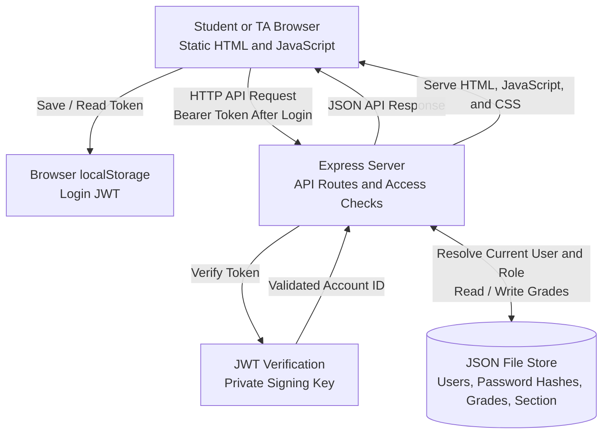

# Marks: Architecture sketch

This sketch describes the patched application.

- **Signing in:** The browser submits a username and password to `POST /api/login`. The server finds the account in the JSON store and checks its password hash with bcrypt. Successful login returns a signed JWT and public user information. Browser JavaScript saves the token under `marks_token` in `localStorage`.

- **Authentication and permissions:** Later API requests send `Authorization: Bearer <token>`. The shared `requireUser()` middleware verifies the token using the private `JWT_SECRET`, accepts only HS256, validates the account ID, and loads the current account. Access checks use its stored role rather than trusting the token's role claim. Invalid tokens or unknown accounts receive 401.

- **Student grade access:** `GET /api/me` returns the signed-in user's grades. `GET /api/students/:id` allows a student to read only their own record; a TA may read any student record. The server validates the requested ID and rejects unauthorized cross-student requests with 403.

- **TA section and grade entry:** `GET /api/section` returns the section's students, grades, and instructor note only to a current TA. `POST /api/grades` also requires a TA and appends a mark to the JSON store. The existing browser page displays the TA section; grade entry is exposed through the API.

- **Page rendering:** Express serves `public/index.html`, `public/app.js`, and CSS. The browser fetches JSON and builds the student or TA display. Dynamic text is HTML-escaped before insertion into the page, so grade titles and other displayed values are treated as text. This application uses neither EJS templates nor SQLite.

- **Storage and setup:** `lib/store.js` reads and writes users, bcrypt password hashes, grades, and section information in one JSON file. `DATABASE_PATH` overrides the original local default, `lib/data/marks.json`; Docker uses `/app/data/marks.json`. A fresh store requires a private `INITIAL_TA_PASSWORD` for the TA account. Existing credentials are changed only through an explicit reset. Persistent hosting storage is needed to retain changes across redeploys.

- **Signing out:** Browser JavaScript removes the token from `localStorage` and returns to the sign-in view. This removes that browser's saved token; it does not revoke copies elsewhere. Tokens expire after seven days, and rotating `JWT_SECRET` invalidates tokens signed with the previous key.
