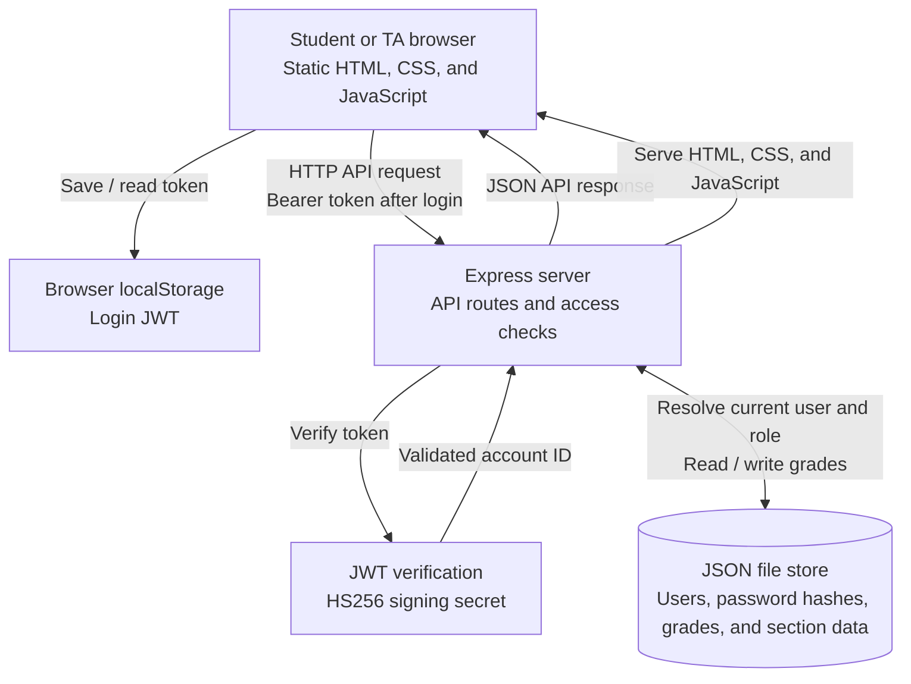

# Marks: Architecture sketch

This sketch describes the patched application.

- Signing in: The browser submits a username and password to `POST /api/login`. The server looks up the account in the JSON store and verifies the password hash with bcrypt. On success, it issues a JWT and returns it to the browser.

- Authentication and permissions: Later API requests include `Authorization: Bearer <token>`. The shared `requireUser()` middleware verifies the token using the server’s `JWT_SECRET`, ensures the requester is authenticated, and enforces role-based access checks on protected routes.

- Student grade access: `GET /api/me` returns the signed-in user’s grades. `GET /api/students/:id` allows a student to read only their own record; a TA may read any student record.

- TA section and grade entry: `GET /api/section` returns the section’s students, grades, and instructor note only to a current TA. `POST /api/grades` also requires TA privileges and appends a mark to the JSON store.

- Page rendering: Express serves `public/index.html`, `public/app.js`, and the CSS files. The browser fetches JSON from the API and renders the appropriate student or TA interface. Dynamic text is HTML-escaped before insertion into the page to reduce the risk of injection.

- Storage and setup: `lib/store.js` reads and writes users, bcrypt password hashes, grades, and section information in a single JSON file. `DATABASE_PATH` overrides the default local file path, allowing the app to use a different storage location when deployed.

- Signing out: Browser JavaScript removes the token from `localStorage` and returns the user to the sign-in view. This clears the browser’s stored token, but it does not revoke any copies that may already exist elsewhere. Tokens expire according to the configured JWT lifetime.
